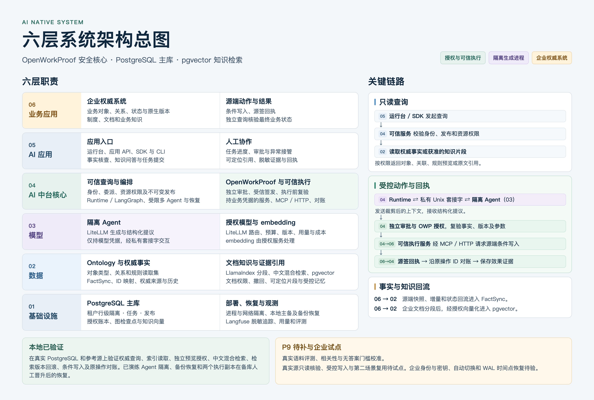

# AI Native System

<!-- mcp-name: io.github.dengyier/ai-native-system -->

面向企业业务的 AI 原生框架，用于构建可审批、可验证、可恢复的 Agent 工作流。应用声明业务对象、关系、规则和动作，Agent 根据获准的事实和知识提出建议。涉及业务写入时，可信执行服务核对审批、OpenWorkProof 授权和源系统版本，再执行条件写入并核验签名回执。

[六层架构](docs/六层系统架构与复用方案-OpenWorkProof.md) · [快速开始](#快速开始) · [接入应用](#接入应用) · [已实现与待完成清单](docs/六层能力核对.md)

## 六层架构

| 层 | 负责什么 |
| --- | --- |
| 1. 基础设施 | PostgreSQL 持久化业务状态、发布、审计与检查点。采用行级租户隔离，并提供部署、观测和恢复演练入口 |
| 2. 数据 | Ontology 声明对象和关系。事实同步记录来源、版本、冲突与历史。文档经 LlamaIndex 分段，在 PostgreSQL 和 pgvector 中进行权限内的中文混合检索 |
| 3. 模型 | LiteLLM 路由生成和 embedding，记录调用用量与成本，并通过 Langfuse 上报脱敏观测数据 |
| 4. AI 中台核心 | Agent Runtime 和 LangGraph 编排阶段、审批与恢复。OpenWorkProof 绑定动作授权，可信执行服务通过 MCP 或 HTTP 执行并对账 |
| 5. AI 应用 | Python SDK、应用 API 和浏览器运行台承载问答、事实核查、审批、任务和证据 |
| 6. 企业业务应用 | 通过连接器读取业务系统的权威对象、关系和版本。获准的业务动作以条件写入、源端签名回执和可核验终态闭环 |



Agent 进程只持模型侧凭据，从可信服务收到按权限裁剪的上下文。业务凭据由执行服务持有。已批准动作在派发前复核当前事实、资源权限与签名，源端结果不确定时按原操作 ID 查询回执。 [可编辑架构图](docs/六层系统架构总图.md) · [Agent 隔离及恢复演练](docs/P9-企业试点与恢复演练.md)

## 快速开始

### 本地演示

在仓库根目录使用 Python 3.11–3.15。命令使用内置模型和合成配置，在临时 SQLite 数据库中运行，无需下载模型或提供密钥。

```bash
ai_native_tmp=$(mktemp -d)
python3 -B -m ai_native_system --db "$ai_native_tmp/framework.sqlite" demo
```

| 演示 | 可观察结果 |
| --- | --- |
| `single` | 单 Agent 读取对象、引用规则提出建议。模拟审批后，对象 `asset-1` 由 `pending` 变为 `verified` |
| `collaboration` | 两个 Agent 阶段通过结构化记录交接。模拟审批后，`artifact-1` 按关联对象状态由 `draft` 变为 `published` |

输出包含阶段状态、审批、事件和动作回执。日常 CLI 帮助可用 `python3 -m ai_native_system --help` 查看。

### PostgreSQL 和 pgvector 集成验证

准备 uv、可用的 Docker Engine 和 Docker Compose。以下脚本创建独立临时测试库。实测环境使用 Python 3.12、PostgreSQL 18.7 和 pgvector 0.8.7。

```bash
uv sync --locked --all-extras --python 3.12 --no-build
uv run --locked --all-extras --python 3.12 python -B deployment/local-postgres/verify.py
uv run --locked --all-extras --python 3.12 python -B deployment/local-postgres/verify_p7.py
uv run --locked --all-extras --python 3.12 python -B deployment/local-postgres/verify_p8.py --only applications
```

第一个验证脚本检查连接池、事务、角色和向量距离。P7 覆盖文档入库、索引与文档权限、中文混合检索、引用和记忆。P8 验证参考应用沿用权限、检索与可信执行。 [环境与锁定依赖](docs/P0-环境验收.md) · [P7 验收](docs/P7-权限知识检索与评测验收.md) · [P8 验收](docs/P8-通用应用SDK与运行台验收.md)

## 接入应用

1. 以 [Registry 样例](fixtures/conformance.json) 为起点，声明类型、关系、动作、角色和 Agent 阶段，通过 `--registry` 加载。
2. 以 [P8 应用目录](fixtures/p8-applications.json) 和 [P8 Registry](fixtures/p8-registry.json) 登记权限内问答、指定范围依据摘编或版本约束的业务动作。应用使用相应发布、文档与工具权限。 [应用接入与 SDK 用法](docs/P8-通用应用SDK与运行台验收.md)
3. 接真实对象时，按 Ontology 发布定义映射源 ID、权威字段、关系及业务版本。使用只读接口验证规则的满足、不满足与依据不足，再按已验收的审批和源条件决定写入范围。 [Ontology 与规则验收](docs/P2b-双源事实同步与规则验收.md) · [首个只读试点清单](docs/P9-首个真实业务只读试点填写清单.md)
4. 接入业务写动作时，分开配置请求者、审批者和执行服务，绑定动作、目标、规则与源版本。使用稳定的请求键和操作 ID 保持重试幂等，按原操作核对签名回执。 [OpenWorkProof 授权](docs/P3-OpenWorkProof授权与执行验收.md) · [MCP 条件写入与签名回执](docs/P4-MCP条件写入与证据闭环验收.md)

### Python 发行包与 MCP 服务端

主框架的 wheel 可从 [GitHub 发布页](https://github.com/dengyier/AI-Native-System/releases) 下载。安装后用 `ai-native-system --db demo.sqlite demo` 运行本地演示。接入 PostgreSQL 的环境可安装 wheel 的 `postgres` 和 `integrations` 可选依赖。

```bash
python -m pip install 'ai_native_system-0.1.0-py3-none-any.whl[mcp]'
```

用 MCP 客户端以 stdio 启动 `ai-native-system-mcp`，并提供部署端 API 地址 `AI_NATIVE_API_URL` 与访问令牌 `AI_NATIVE_API_TOKEN`。服务端提供 `list_applications` 和 `get_task` 两种只读工具，使用当前 API 身份的授权。远端 API 使用 HTTPS，本机回环允许 HTTP。

支持 MCPB 0.4 与 UV 的客户端可安装 [AI Native System MCPB](https://github.com/dengyier/AI-Native-System/releases/download/v0.1.0/ai-native-system-0.1.0.mcpb)，并按提示填入 API 地址和令牌。 [官方 MCP Registry 条目](https://registry.modelcontextprotocol.io/v0.1/servers/io.github.dengyier%2Fai-native-system/versions/0.1.0)

主框架及 MCP 服务端适用根目录的非商业使用许可。独立 Python SDK 和企业动作接口定义采用 MIT。 [主框架与 MCP 许可](LICENSE.md) · [MIT SDK](ai_native_sdk/README.md)

### 使用自己的 PostgreSQL 测试库

数据库管理员先在独立测试库启用 `public` schema 下的 pgvector 扩展，并将 `ai_native` schema 的所有权交给迁移角色。通过环境或密钥服务提供 `AI_NATIVE_POSTGRES_MIGRATION_DSN` 和最小权限的 `AI_NATIVE_POSTGRES_DSN`。下面命令使用已安装集成依赖的 Python 环境，模型配置通过 `model_config` 指向本地文件。

```bash
python -m ai_native_system --postgres migrate
python -m ai_native_system --postgres --registry fixtures/p8-registry.json \
  --models "$model_config" serve --application-catalog fixtures/p8-applications.json
```

完成企业身份、权限和发布配置后，在本机访问 `http://127.0.0.1:8789/console/`。实际连接信息和密钥通过部署环境提供。 [主库与迁移](docs/P1b-主库迁移验收.md) · [身份、委派和发布](docs/P2a-企业身份权限与发布验收.md) · [模型配置样例](fixtures/p8-models.example.json)

### 中文混合检索

为请求主体授予实际知识索引的 `read / knowledge-index / 索引ID` 权限及当前文档的读取权限。执行迁移后，拥有词法索引读取权限的服务可用 `--method hybrid` 查询。问答及摘编应用可在目录条目加入 `"retrieval_method": "hybrid"`。默认配置使用精确向量检索。

```bash
python -m ai_native_system --postgres --tenant "$tenant" --models "$model_config" \
  p7 search '“保留审批记录”' --method hybrid --actor "$actor"
```

中文词组与向量候选在同一授权范围内融合，完整条款号和带引号的连续短语支持精确匹配，返回正文前复核权限与原文引用。 [索引授权与启用步骤](docs/P9-企业试点与恢复演练.md#中文混合检索)

需要稳定复跑时，在应用发布草稿中显式固定知识索引和检索方法。用 `release select` 切换发布或回到仍有效的旧发布，系统在移动指针前校验目标索引的文档覆盖和模型配置。 [固定发布与回滚](docs/P9-企业试点与恢复演练.md#发布固定检索索引与回滚)

## 关键契约

| 模块 | 作用 |
| --- | --- |
| [Ontology](ai_native_system/ontology.py) · [Registry](ai_native_system/registry.py) | 声明领域类型、关系、规则、应用与动作 |
| [Runtime](ai_native_system/runtime.py) · [图编排](ai_native_system/graph_runtime.py) | 管理 Agent 阶段、结构化交接、人工审批和持久恢复 |
| [知识检索](ai_native_system/knowledge.py) · [中文词法查询](ai_native_system/knowledge_lexical.py) | 在同一索引与权限范围内召回并复验原文 |
| [OpenWorkProof 执行校验](ai_native_system/owp_gate.py) · [动作与回执契约](schemas/ai-native-action-v0.1/README.md) | 绑定审批、事实、权限和源端证据 |
| [应用 API](ai_native_system/api.py) · [Python SDK](ai_native_sdk/client.py) · [运行台](console/) | 访问获准的应用、任务、事实、审批与证据 |

Python 客户端可独立安装，通过 `from ai_native_sdk import Client` 连接已部署的应用接口。下载包、用法和只读示例见 [SDK 文档](ai_native_sdk/README.md)。

<details>
<summary>在本地手动推进一个任务</summary>

```bash
ai_native_tmp=$(mktemp -d)
ai_native_db="$ai_native_tmp/manual.sqlite"
python3 -m ai_native_system --db "$ai_native_db" init

task_id=$(python3 -m ai_native_system --db "$ai_native_db" \
  submit single asset-1 --actor requester --request-key manual-1 |
  python3 -c 'import json, sys; print(json.load(sys.stdin)["id"])')

python3 -m ai_native_system --db "$ai_native_db" advance "$task_id"
python3 -m ai_native_system --db "$ai_native_db" decide "$task_id" approve --actor reviewer
python3 -m ai_native_system --db "$ai_native_db" advance "$task_id"
python3 -m ai_native_system --db "$ai_native_db" inspect "$task_id"
```

在独立的演示任务上，执行阶段可使用 `advance … --simulate-timeout before-commit` 或 `after-commit` 分别模拟提交前超时与提交后确认丢失。后续使用同一任务 ID 推进或查看，核对对象版本与回执。

</details>

<details>
<summary>可选的本机模型接入</summary>

设置 `AI_NATIVE_MODEL_BASE_URL`、`AI_NATIVE_MODEL_NAME` 和服务需要的 `AI_NATIVE_MODEL_API_KEY`，为本地演示接入支持 Chat Completions JSON 输出的模型。若已有 GGUF 模型与 `node-llama-cpp`，可先启动本机回环桥接。

```bash
AI_NATIVE_LLAMA_RUNTIME_DIR="/path/to/runtime" \
AI_NATIVE_GGUF_MODEL_PATH="/path/to/model.gguf" \
node local_model.mjs
```

将模型 URL 设为 `http://127.0.0.1:8798/v1`，模型名使用 GGUF 文件去掉扩展名的名称。企业模型路由、费用预算、观测和回退配置见 [P5 模型接入验收](docs/P5-模型接入与观测验收.md)。

</details>

## 当前验证范围

- P0–P8 已完成本地验收，包括真实 PostgreSQL 上的企业身份与权限、事实同步、OpenWorkProof 执行、源签回执、模型路由、断点恢复、知识检索和参考应用。
- P9 已在本地验证 Agent 隔离、双执行副本在 PostgreSQL 主备切换后的恢复、备份恢复、Ontology 权威只读查询、独立规则预览授权和中文混合检索。索引与检索策略固定、切换及回滚已用 PostgreSQL 18.7 和 pgvector 0.8.7 验收，包括旧索引覆盖不足时拒绝回滚，以及补齐后带审计切回。 [P9 验收与复跑](docs/P9-企业试点与恢复演练.md#发布固定检索索引与回滚)
- 计划内后续工作包括真实中文语料的质量与性能评测，以及指定企业环境的业务对照和受控写入试点。 [P9 依赖与验收标准](docs/superpowers/plans/2026-11-16-six-layer-owp-integration.md#p9-检索治理与语料评测)

## 许可

Copyright © 2026 dengyier. 原创代码、文档及架构图的知识产权由 dengyier 持有。主框架采用 [AI Native System 非商业使用许可 v1.3](LICENSE.md)。

主框架的个人学习和非商业使用免费。将主框架用于企业生产、客户交付、收费托管等商业用途，须事先获得单独书面授权。GitHub 平台内的查看与 Fork 适用平台服务条款，对外分发和再许可依项目许可执行。 [商业授权联系 dengyier](https://github.com/dengyier)

由 dengyier 上传到 PyPI 的安装包可依许可第 4 条原样免费分发和镜像。

独立 Python SDK 和接入示例，以及企业动作接口定义及配套说明，可按 MIT 许可使用。 [SDK MIT 许可](ai_native_sdk/LICENSE) · [接口定义 MIT 许可](schemas/ai-native-action-v0.1/LICENSE)

第三方依赖适用各自的上游许可证。 [依赖与许可证](docs/P0-环境验收.md#锁定版本与许可)
