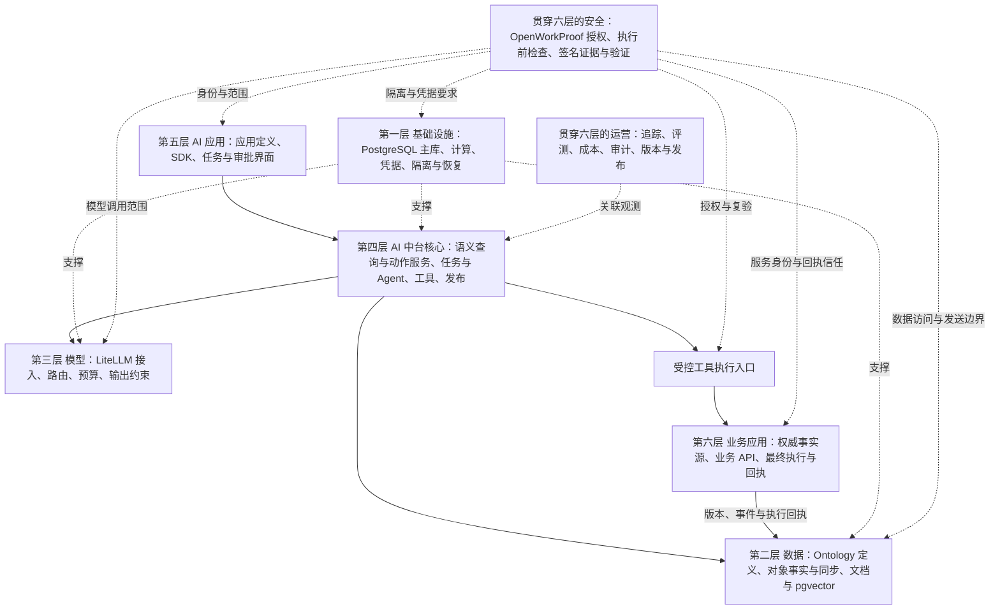

# 六层系统架构与复用方案：以 OpenWorkProof 为安全核心

日期：2026-11-16（北京时间）。本文件记录六层目标架构。实施状态由开发计划与能力清单记录。[依赖顺序与验收计划](superpowers/plans/2026-11-16-six-layer-owp-integration.md) · [深入审查](六层架构深入审查-2026-11-16.md) · [P0 环境验收](P0-环境验收.md)

## 1. 目标、范围与状态口径

建设与行业无关的企业 AI 原生框架。不同应用通过配置和适配器复用任务运行、模型、知识、工具和治理服务。采用原文的六层职责划分：基础设施、数据、模型、AI 中台核心、AI 应用、业务应用。OpenWorkProof（OWP）作为贯穿六层的授权与证据核心，身份、数据权限和执行隔离与其配合。

本方案以 OWP 为安全核心，PostgreSQL 为正式主库，知识向量存储与检索采用 PostgreSQL 的 pgvector 扩展。按依赖增量开发，项目实现与集成代码位于 [ai_native_system](../ai_native_system/)。

SQLite 保留为既有基线与轻量演示，后续主要开发、集成与并发验收以真实 PostgreSQL 为准。PostgreSQL + pgvector 保存并查询向量，LlamaIndex 负责文档处理与检索流程。

采用以下状态，避免把组件能力写成本系统进度：

| 状态 | 含义 |
| --- | --- |
| 本地已实现 | 本项目已有实现；只承诺当前测试覆盖的行为 |
| 外部已有，未接入 | OWP 或第三方已有对应能力，本项目尚未集成或验证 |
| 待开发 | 需要新增框架契约、适配、服务或测试 |
| 条件扩展 | 完整路线的一部分，达到指定需求后建设 |

框架的 SQLite 入口只依赖 Python 标准库。P1a 已验收 Ontology、事实、连接器和通用动作契约。P1b 已验证 PostgreSQL 显式迁移、旧数据导入、并发运行和回执恢复，P2a 已在真实 PostgreSQL 验证租户隔离、企业身份和委派、资源权限及不可变发布。P2b 已验双源事实同步、冲突与规则复验。P3 已将 OpenWorkProof 接入执行。P4 已在真实 PostgreSQL 和独立参考源验收 MCP 官方 SDK、源侧条件写入、源签回执和证据闭环。[P0 环境验收](P0-环境验收.md) · [P1a 契约验收](P1a-契约验收.md) · [P1b 主库验收](P1b-主库迁移验收.md) · [P2a 企业治理验收](P2a-企业身份权限与发布验收.md) · [P2b 双源事实与规则验收](P2b-双源事实同步与规则验收.md) · [P3 授权与执行验收](P3-OpenWorkProof授权与执行验收.md) · [P4 工具与证据验收](P4-MCP条件写入与证据闭环验收.md)

## 2. 总体架构

[六层系统架构总图](六层系统架构总图.md) 展示六层职责、只读与执行链路、信任边界和 P9 待补能力。

六层是逻辑职责，不要求六套独立微服务。下一阶段采用模块化 Python 服务、PostgreSQL 主库和可替换适配器。P0 确定兼容环境；P1a 先固定 Ontology 最小契约，P1b 据此完成 PG 主库与迁移；P2a 实现身份、语义查询权限与本体发布，P2b 完成事实同步及规则判断；P3 将这些语义绑定到 OWP 授权；P7 建设 pgvector 知识检索。生产复制、故障切换和调度扩展留在企业部署阶段。P1a/P1b 为 P1 内部顺序，P2a/P2b 为 P2 内部顺序。

第六层由接入企业拥有权威事实和业务动作。本地对象可作为测试事实或事实投影，不能在真实接入后自动成为业务权威。框架管理调用、授权与证据，模型负责提出建议；执行许可由可信服务决定。

## 3. 六层职责、复用与自研边界

| 层次 | 完整目标 | 本地已实现 | 复用组件或企业能力 | P9 待补齐与试点重点 |
| --- | --- | --- | --- | --- |
| 1 基础设施 | 持久存储、后台执行、资源与网络隔离、凭据管理、备份恢复 | PG 迁移、租户 RLS、有界连接和只读事务、Agent 容器隔离、实库物理切换与备份恢复已本地验证 | PostgreSQL、企业网络与密钥管理；长任务调度按需复用 Temporal | 企业拓扑中复验自动切换、WAL 恢复，以及建索引和入库并发时的业务事务负载 |
| 2 数据 | 本体定义、对象身份、关系、事实历史与来源、同步、知识和权限 | P1a/P2b 已验本体契约、身份映射及双时间事实。P7/P9 已实现分段向量化、中文词法索引、混合检索、索引与文档权限、撤回和引用复验、发布固定和索引回滚 | PostgreSQL 存本体、关系、事实和词法索引，pgvector 和 LlamaIndex 处理向量和分段 | 接真实权威源与语料并核对完整性 |
| 3 模型 | 多供应商调用、路由、数据适用范围、用量、预算和质量管理 | P5 已验 LiteLLM、发布固定路由、数据裁剪和预算。P9 已验模型提议在独立 Agent 中生成 | LiteLLM、试点模型网关 | 固定 embedding 和预处理版本，使用真实样本评测候选排序、引用质量及证据不足时的行为 |
| 4 AI 中台核心 | 语义查询、动作服务、Runtime、Agent、工具、权限、证据与发布 | P9 已验权威查询、独立预览授权、混合检索、应用发布固定和回滚。P3/P4 有签名授权、条件写入和对账，P6 有持久检查点 | OpenWorkProof、LangGraph、MCP 官方 SDK、Langfuse；复杂授权可选 OpenFGA | 联调真实权威源与企业部署 |
| 5 AI 应用 | 应用注册、调用 SDK、任务进度、审批和接管、应用版本管理 | P8 已验 SDK、运行台、字段事实状态、审批详情与脱敏证据。P9 事实核查已接应用权威详情和规则预览 | 现有运行台与企业应用 API | 验收实际角色的预览和索引权限，展示可核对引用与检索版本，验证依据不足及试点回退 |
| 6 业务应用 | 权威对象、事实变更、有限权限动作和可核对回执 | P2b/P4 已在参考源验证读写与回流。P8 已验三类参考应用共用框架 | 企业现有 API、主数据、身份和业务审批流程 | 业务负责人核对真实对象、制度和查询标注，再验一个受控写动作。第二场景衡量复用 |

## 4. 组件选型与维护边界

| 组件 | 采用决定 | 只承担的职责 | 不应重复维护的能力 |
| --- | --- | --- | --- |
| PostgreSQL | 已确定为正式主库，P0/P1 优先建设 | 任务、对象、审批、操作、授权持久记录、版本与证据索引 | 不再为正式主库保留无期限的多数据库选型分支 |
| pgvector | P7 已接入，P9 保留为正式知识向量后端及性能对照基线 | PostgreSQL 内的向量存储、距离计算与向量索引 | 关键词检索和混合排序由同一知识检索服务管理 |
| SQLite | 保留已有基线及轻量演示 | 原有行为验证、迁移来源 | 不以 SQLite 测试替代 PostgreSQL 事务、RLS 和并发验收 |
| OWP Python Core | 安全核心，优先接入 | 可验证授权、人工决定权、签名与证据机制 | 通用密码算法和签名校验不另造一套 |
| OWP Rust | 保留后续替换路径 | 已迁移的摘要、验签等基础能力 | 不把当前 Rust 工具集当成完整 Python Core |
| MCP 官方 Python SDK | 优先采用 | 协议、会话、发现和传输 | 减少手写 MCP 消息和会话处理 |
| LiteLLM | 采用为模型后端 | 供应商适配、允许范围内的路由、用量与代理能力 | 不扩写大量供应商专用客户端 |
| LangGraph | 采用为 Agent 编排后端 | 分支、并行、循环、中断、检查点 | 不自研完整图执行引擎 |
| LlamaIndex | 知识阶段采用 | 文档接入、转换、索引与检索 | 不同时启用其另一套 Agent 编排作为任务主控 |
| Langfuse | 追踪阶段采用，随后接评测 | 调用链、提示版本、质量与成本分析 | 不自建通用 LLM 观测后台；业务审计仍独立持久化 |
| Temporal | 条件扩展 | 长时间等待、多 Worker、持续调度与故障恢复 | 不与现有循环和 LangGraph 同时重试同一动作 |
| OpenFGA | 条件扩展 | 复杂对象关系授权判断 | 不承担登录认证、签名信任或审批流程 |
| Dify / CrewAI | 本期不引入底层 | Dify 可作应用入口；CrewAI 留作场景备选 | 保持一个明确的 Agent 编排主路径 |

P0 在 `pyproject.toml` 声明可选集成依赖，`uv.lock` 锁定版本和分发文件哈希。在 CPython 3.12.13 实测 OWP、MCP SDK、LangGraph 和其他组件的安装与导入。现有 SQLite 框架另在 Python 3.14.5 通过回归。[P0 环境验收](P0-环境验收.md)

OWP Core 及 aisoc 使用各自许可证；LiteLLM 与 Langfuse 的企业目录有独立许可；Dify 对多租户运营和前端标识有附加条件。代码依赖、商业托管和企业功能分别核对，不能将宣传页展示的所有功能记为免费自托管能力。具体来源见第 11 节。

### 4.1 PostgreSQL 与 pgvector 的存储分工

| 数据 | 存储选择 | 所有权与约束 |
| --- | --- | --- |
| 任务、对象、关系、审批、发布、操作及对账 | PostgreSQL 关系表 | 本框架为表与迁移负责，远端业务事实仍以源系统为准 |
| OWP 授权引用、nonce、撤销、证据投递与验证记录 | PostgreSQL 关系表 | 通过持久事务和唯一约束落实防重放与一致性，签名/验证语义仍由 OWP 适配负责 |
| 文档与片段元数据、权限、版本、向量 | PostgreSQL + pgvector | 向量和片段权限、文档版本关联，查询不能绕过访问范围 |
| 原文、大文件、生成产物、签名证据包 | 文件/对象存储，PG 保存定位和摘要 | 原始文件保持独立；PG 索引不是签名证据包的替代品 |
| Agent 检查点 | 采用兼容的 PostgreSQL 检查点后端 | 单独的表命名空间与迁移归属，不与任务/操作表混写 |
| 可重建的缓存 | 起步不要求独立服务 | 有性能证据后增加缓存，不让缓存成为授权或回执的唯一来源 |

初期框架业务表和知识向量使用同一 PostgreSQL 部署，通过独立表/命名空间和最小权限账号划分职责。迁移账号与运行账号分离。第三方服务按各自支持的数据库及迁移方式部署；此选型不意味着把 Langfuse、Temporal 等所有内部存储都强行放到框架数据库中。知识负载影响核心事务时，可将向量检索迁至独立 PostgreSQL 实例，仍保持 pgvector 技术路线。

租户隔离同时使用应用授权与 PostgreSQL 行级安全（RLS）。运行账号不得为超级用户、BYPASSRLS 角色或可绕过策略的表所有者；必要时强制表所有者受 RLS 约束。租户上下文从可信身份进入事务，连接归还后不得残留，缺上下文默认拒绝。RLS 只作为可信服务的数据库侧防线，不向 Agent 暴露可自行设置身份的任意 SQL 通道。

PG 主库引入后，任务领取、nonce 消费、预算预留、对象版本更新及证据投递均在真实 PG 并发连接上验收。网络调用不放进长数据库事务。PG 事务不能覆盖远端业务系统的提交，现有稳定操作 ID、幂等和对账机制继续保留。SQLite 导入采用停止旧写入、备份、复制与校验、切换单一写入方的首版流程；不默认双写。

### 4.2 基础设施深入审查后的约束

PG 接入阶段 P1b 即完成显式迁移、条件状态转换和统一锁顺序、数据库侧租约、有限连接池/超时、就绪与排空、基础运行指标、单实例备份恢复。P2a/P3 补齐租户和授权的跨层验证。P9 在本地实库验证同步主备、旧主隔离、备库晋升和多副本恢复连接。指定环境需测量自己的恢复目标。具体并发与隔离用例见深入审查 D1-02 至 D1-07。

授权的事实复验与本地提交需有所有相关写入共同遵守的锁/范围修订协议，单纯写“在同一事务”不足以保证。旧领取持有者不能提交，晚到失败不能覆盖已成功操作，提交后连接断开先按原 ID 查询结果。

恢复旧数据库后先冻结新写入、隔离旧写入者，并核对外部效果、当前撤权和签名证据。恢复出来的“未执行”或“仍获授权”不能直接作为执行依据；恢复代次或重新授权需可信且不随同一备份回滚。证据文件、验证材料和数据库引用一并纳入恢复清单。

PG 与 pgvector 共库期间限制文档导入、向量化和建索引资源，保护授权/回执容量；测量后仍不满足目标才分离实例。当前不增加无实测依据的消息中间件、缓存或集群组件。

## 5. OpenWorkProof 安全架构

### 5.1 当前可复用证据与适配缺口

当前框架使用锁定的 OpenWorkProof Python SDK 1.6.1，本方案按实际 SDK 能力决定集成边界。[OpenWorkProof](https://github.com/dengyier/OpenWorkProof)

| 能力 | 核对来源 | 进入本框架的方式 |
| --- | --- | --- |
| WorkOrder、CapabilityGrant、人工授权交集 | `src/openworkproof/models.py`、`agency_policy.py` | 复用授权规则；先定义适用于企业资源的映射 |
| 人工授权撤销、替换与签名历史 | `agency_policy.py`、`agency_ledger.py` | 复用语义，接入本框架当前授权查询与持久记录 |
| 签名、规范字节、外部授权检查点 | `signing.py`、`authority.py` | 使用独立可信公钥与签名主体，固定协议/摘要版本 |
| 调用前验证、nonce、防重放、独立执行凭证 | `src/aisoc/sandbox/pep.py` | 参考执行检查顺序；单机内存记录改为持久原子记录；真实工具另做适配 |
| Guard | `agent_guard.py`、Guard 文档 | 已验证用途限于特定 Codex 本地编辑路径，不能当成通用网络/主机隔离 |
| Rust 基础组件 | `rust/README.md` | 当前仅复用已支持且通过对应契约测试的能力 |

关键适配缺口：现有 WorkOrder 含 repository、branch、source_commit、补丁和测试配置等必需字段；部分工具种类固定为代码操作。不得把任意企业动作伪装成仓库操作，也不得删掉校验来换取兼容。

P3 已实现框架自己的企业动作 profile `ai-native-action/v0.1`。它复用 OpenWorkProof 1.6.1 的编码与签名基础，使用独立 Schema、签名域及验证器表达企业对象、动作和范围。现有工具执行入口使用 PostgreSQL 保存权限和单次消费，证据采用独立的签名域。

### 5.2 安全职责分工

有效执行权限是企业身份/资源权限、任务范围、能力授权、当前人工授权和动作前置条件的交集。任一检查失败即不执行。模型输出、文档内容、工具返回文本不能作为扩权依据。

| 边界 | 强制措施 | 实施方 |
| --- | --- | --- |
| 身份进入框架 | 从可信认证得到 tenant、actor、服务身份；正文不能覆盖身份 | 身份适配器与 API |
| 读取对象/文档/记忆 | 检索前过滤权限，引用返回前复核；缓存按租户、主体授权范围与版本隔离 | 数据服务与资源权限层 |
| 索引读取与规则预览（P9 已本地验证） | 知识查询按实际解析的索引版本授权，文档和撤回另行复核。规则预览取得独立动作预览授权与必要字段、边和目标对象读取权限 | 知识检索服务、语义查询与资源权限层 |
| 向模型发送数据 | 检查数据分类、允许供应商、敏感字段、上下文与预算；回退不能越出允许集合 | 模型服务与策略入口 |
| Agent 请求工具 | 固定工具和版本、目标、参数摘要、任务/操作标识、授权期限与审批 | OWP 适配及执行入口 |
| 工具产生副作用 | 独立执行服务持有受限凭据；复查授权/对象版本并落实幂等 | 工具执行器与接入系统 |
| 证据保存与导出 | 关联签名主体和原始回执来源、权限、保留/删除策略、独立验证材料 | OWP 证据服务 |
| 运行隔离 | 限制文件、进程、网络出口和资源；Agent 无法读取生产执行凭据 | 部署与执行环境 |

企业身份由部署方提供，本框架不重建用户目录。初期可用测试身份验证契约；企业上线前必须接真实身份系统和可信签名密钥管理。OpenFGA 是复杂资源授权的可选后端，不是前置必装组件。

CLI、HTTP、LangGraph 节点和自动任务都调用同一受 OpenWorkProof 保护的执行入口。P9 将 LiteLLM 提议生成放到独立 Agent，由执行服务经私有套接字提交裁剪上下文并复核返回结果。已验证 Agent 容器无法读取业务凭据或连接数据库和源端网络。试点须用指定的模型网关和业务网络复验隔离和故障恢复。

### 5.3 授权、执行、对账与证据流程

1. 认证请求，解析应用发布版本及任务范围，生成任务标识。
2. 以当前权限获取事实和证据，调用获准模型生成提议。
3. 对提议进行动作与参数校验，形成精确授权材料；需要人工决定的动作进入审批。
4. 执行前复验当前身份、授权撤销、审批、参数、目标、对象版本和截止时间。持久保存执行意图，再发起网络调用。
5. 本地工具在事务内提交；远端工具使用稳定操作标识。远端结果未知进入对账，未确认前不换操作 ID 重新执行。
6. 记录真实业务回执，与授权和参数绑定；投影冲突保留原始回执，进入人工处理。
7. 通过持久证据投递记录生成签名证据，验证器使用独立信任来源检查。验证和人工验收分别记录。

任务可包含多个动作时，操作标识按任务内的稳定动作实例分配；重试同一动作复用同一标识，不把所有动作都等同于 task_id。既有单动作任务保持旧 ID 与摘要语义，防止升级后重复执行。

nonce 防止未经允许的重放，operation_id 用于识别同一业务效果，两者不能混用。重复提交已登记的相同操作应返回既有状态/回执；结果未知先查询；再次发送须符合明确重试策略且保留原操作身份。

签名服务不可用时，尚未完成必需授权签名的动作不执行。若远端已成功但后续证据封装失败，保留业务成功事实和待补证状态，恢复签名工作，不重新执行动作。通过事务性投递记录/补偿扫描处理数据库与证据服务之间的中断，禁止用跨服务“同时提交”假设掩盖缺口。

查回执采用专门受限的对账服务身份；撤销写权限后仍可按授权核实既有操作，但不能借对账再次写入。取消只能停止尚未开始的操作；已发出的操作先确认结果，撤回或补偿属于新的受控动作。

签名证明签名主体声明的内容和完整性。下游自行签名的回执与适配器观察后签名的记录必须区分，后者不能冒充业务源签名。缺少可信公钥、必要证据或新鲜授权时保留明确的未知结论。证据验证通过不等于业务结果正确或人工验收通过。

### 5.4 Ontology、事实与 OWP 的授权绑定

Ontology 定义资源和业务语义，身份/资源权限决定可访问范围，OWP 验证本次委托及证据，执行器落实动作。四者分别拥有规则，统一取交集；禁止在提示词、Ontology 和 OWP 适配中维护三份互相独立的业务条件。

每个拟执行动作的授权材料增加以下绑定，并由确定性适配器生成：

| 绑定 | 内容 | 变化后的处理 |
| --- | --- | --- |
| 语义定义 | 本体发布 ID/摘要、动作类型/版本、参数与结果 Schema、规则集版本 | 与任务发布不兼容、被撤回或适用规则切换时，阻止旧动作并重新评估/审批 |
| 资源与参数 | 租户、规范对象 ID、关系/字段作用范围、目标源系统、工具目的地、参数摘要 | 替换对象、字段或目标不能沿用旧授权 |
| 事实读取集 | 对象/关系/来源断言版本、证据引用、有效时间、查询时点和来源同步进度 | 相关版本变化、来源冲突、证据撤回或超出新鲜度要求时阻止执行 |
| 集合依据 | 影响动作的查询范围、结果摘要及对应范围修订标识 | 新增/删除关系或集合成员不能绕过只检查旧对象版本的复验 |
| 当前许可 | 主体、委托链、权限判断引用、人工决定、截止时间与撤销状态 | 当前撤权优先于旧发布和历史有效签名 |

只发布一个新本体版本，不自动使所有旧任务失效；仍被支持的旧版本可按固定语义恢复。规则被撤回、适用策略改变、数据迁移不兼容或相关事实变化时，旧批准不再足以执行。首次实现对与动作相关的读取集采用保守复验；不要求整个企业图保持全局一致快照。

规则判断返回满足、不满足、信息不足及受权限约束的解释。信息不足不能被转换为允许。仅靠时间戳和签名不能证明源数据完整或新鲜，源系统不提供可靠进度/版本时须明确其能力限制；依赖“某对象不存在”或“所有成员均满足”的高影响动作不能把不完整数据当成证据。

本地动作可在 PG 事务内核对事实版本并提交；远端动作须由源系统原子校验预期版本/前置条件，或提供等效保留机制。仅在调用前刷新一次数据不能消除检查与执行之间的竞争；不具备条件执行能力的连接器不得宣称同等级保证，相关动作需限制或转人工。回执携带 operation_id、获批请求摘要和结果，再关联到既有授权，不事后改写原事实快照。

授权、撤销、nonce 消费和执行前版本判断使用主库或经验证的一致读路径；不默认读取有延迟的副本。对账确认已发生事实与批准新动作分开。多动作任务记录每步效果，已成功步骤不重做；补偿必须有动作定义和新授权，并接受补偿也可能失败的结果。

## 6. 公共契约与数据所有权

P1a 已实现本体、事实、连接器、任务引用、动作与回执契约。P1b 建立相关持久化基础，授权和应用发布完整契约按后续阶段接入。[P1a 契约验收](P1a-契约验收.md)

| 契约 | 必须表达的内容 | 负责模块 |
| --- | --- | --- |
| Task | tenant、actor、application/release、输入、目标引用、预算、任务状态 | 任务服务 |
| OntologyRelease | 命名空间、对象/属性/关系/规则/动作定义、版本、依赖、兼容级别与发布主体 | 本体目录与发布服务 |
| FactAssertion | 规范对象、属性或关系、值、来源/源记录版本、有效时间、记录时间、质量/冲突状态 | 事实服务 |
| SourceEvent | 租户、来源、事件 ID、源对象/版本、变更类别、同步游标、关联操作 ID | 同步接入服务 |
| Action | 动作实例 ID、read/generate/write_local/write_remote 类型、工具版本、参数 Schema、资源范围、前后条件、审批策略、幂等与查询能力 | Registry 与动作服务 |
| Authorization | 任务/动作、本体/规则版本、事实读取集与集合依据、主体/委托链、资源、参数摘要、期限、审批、nonce、签名 | OWP 适配与授权服务 |
| Evidence | 原始来源、版本、内容摘要、访问范围、引用位置、获取时间、撤回状态 | 数据/知识服务 |
| Receipt | 操作 ID、请求摘要、结果与版本、执行主体、来源、签名状态、查询依据 | 执行与对账服务 |
| Release | 应用与图版本、本体/规则/来源映射版本、动作/Schema、模型路由和允许回退、提示词、工具目的地、知识引用策略、OWP profile/策略版本 | 发布服务 |

发布快照锁定可复现配置，但不冻结已撤销的实时权限。旧任务使用原发布版本恢复；当前撤权、密钥失效、知识撤回和安全禁用仍立即限制后续调用。代码版本回滚不自动回滚已发生的业务修改。

| 状态类型 | 权威所有者 | 边界 |
| --- | --- | --- |
| 任务、审批、业务操作与对账 | 本框架持久服务，目标存储为 PostgreSQL | 不从 LangGraph 节点输出直接判定业务已完成 |
| Agent 图节点与短期上下文 | LangGraph 检查点，采用兼容 PG 后端 | 通过 task_id、阶段 ID 关联任务；不再让旧循环驱动同一任务 |
| 权威对象状态 | 企业源系统；本地合成事实在迁移后由 PG 保存 | 当前基线仍为 SQLite；本地投影冲突不能覆盖源回执 |
| 授权与签名证据 | OWP 适配，PG 记录及可信证据存储 | Langfuse trace 不能替代授权凭证 |
| 长任务调度（后期） | Temporal | 每类恢复/重试只有一个负责方，外部副作用仍由执行入口处理 |
| 运行观测 | Langfuse/指标后端 | 只保存允许导出的字段；默认不复制原始敏感正文和秘密 |

模型调用费用也可能因中断后重试而重复，检查点不能保证供应商只计费一次。预算预留、实际调用记录和用量补报需要单独处理。

## 7. Ontology、事实同步、知识与多 Agent

Ontology 由本项目维护类型、关系、状态、源标识和动作规则，正式采用 PostgreSQL 关系存储，不先引入独立图数据库。知识向量存储采用 pgvector，LlamaIndex 负责文档处理和检索流程，不能替代企业语义或权限决策。删除/撤回文档时同步失效向量、索引入口和缓存；保留历史证据的范围按部署方数据政策决定。

### 7.1 本体定义、实例与领域配置

框架提供元模型和验证器，应用通过领域配置包定义业务概念；不把合成演示对象固定成企业公共语义。定义层和事实实例层分开，模型只能提出候选定义/事实，不能自动发布或更改授权规则。

| 构成 | 首版必需内容 | 后续按需求扩展 |
| --- | --- | --- |
| 对象与身份 | 类型与命名空间、租户内稳定对象 ID、源系统/源 ID 映射 | 经审阅的合并/拆分与反向追踪，保留旧引用 |
| 属性 | 类型、可空/必填、枚举、精度、单位、时间语义、敏感级别 | 行业专用值类型 |
| 关系 | 起止类型、方向、可选性、一对多/多对多、基数、关系属性与有效期 | 复杂推理关系 |
| 规则与派生值 | 有版本的有限声明式表达式、输入依赖、单位一致性、三态结果及解释 | 经验证的扩展函数，不开放任意代码执行 |
| 动作 | 参数、对象/字段范围、读取集、前后条件、效果类型、执行器、确认方法、是否可补偿 | 复杂跨系统补偿编排 |
| 事件 | 来源、对象、变化类型、源版本/事件 ID、发生与接收时间 | 高吞吐流处理 |

P1a 已实现本体定义和实例校验，包括基数、单位、规则依赖和字段类型。P1b 保存版本与事实来源，P2a/P2b 接入语义查询、发布及规则求值。对象身份经明确的来源映射建立。

### 7.2 来源、历史、冲突与新鲜度

每条事实保留来源断言，而非只覆盖对象当前值。区分事实在业务上何时有效与框架何时记录；保存属性和关系历史以重建一次决定实际引用的版本。模型抽取、人工确认和源系统事实具有不同来源标签，置信分数不等于授权或真实。

来源权威按对象/属性登记；明确哪个源可以提供或修改哪类事实。冲突进入显式状态并保留各来源，不能按最后收到的记录无条件覆盖。人工修正也记录授权、原因、范围和有效期，源同步不能静默抹去；冲突未解时需要相关事实的受控动作暂停。历史未知的旧 SQLite 对象迁移为已知本地快照，不能补造过去的来源和时间。

新鲜度要求按动作声明，包括允许的数据年龄、源同步延迟和需要即时重读的字段。文档检索可容忍的延迟不自动适用于执行依据。读不到、无权限、冲突、过旧各有内部状态，对外错误只暴露调用者有权知道的信息。

### 7.3 事实同步与连接器契约

P1a 定义连接器契约，P2b 用两个不同的合成源完成同步验收，不等到 P8 才验证数据映射。连接器声明快照/增量读取、源版本、删除、条件写入、幂等和结果查询能力；可先使用轮询和 PG 持久接收记录，无需预设消息中间件。

初次接入记录快照边界和增量游标。事件先持久接收，再在事务中应用事实、更新处理游标和写出失效通知。按租户/来源/事件 ID 去重；同 ID 不同负载进入冲突。旧版本事件不能覆盖新事实，缺少可靠顺序时重新读取权威源或标记不确定，不按接收时间假装有序。中断、间隙和失败记录可重放；只有来源能力足以证明连续性时才报告完整同步。

删除用可追溯的失效标记使当前查询不可见，并失效相关关系、规则缓存、记忆与知识引用；依法或按数据政策删除正文时，独立处理留存证据的权限和期限。正文摘要不保证绝对匿名。基础阶段先提供失效通知契约，P7 将向量/记忆消费者接上，不能在它们尚未实现时宣称完成联动。

写入回执和源同步事件通过操作关联标识核对。重复到达的回执/事件不生成第二个业务效果；不能简单忽略所有来自本平台的变更，以免遗漏源系统最终状态。同步事实更新不自动触发无限写回，自动动作须明确触发规则、去重与循环边界。

### 7.4 权限语义查询与版本治理

**已实现。** `/v1/query` 可按应用解析已选发布，检查应用和发布权限，按对象类型或 ID 查询并投影可见字段。现有关系遍历逐跳读取对象投影上的单个目标，动作发现只列调用者获准看到的动作声明。`/v1/facts/status` 支持单字段权威状态查询。执行侧 `fact_gate.assess` 已按发布绑定调用 `RuleEvaluator`，读取完整的权威事实及关系集合，在 OpenWorkProof 授权时绑定本体和规则版本、事实读取集与权限范围。[应用查询入口](../ai_native_system/api.py) · [查询投影](../ai_native_system/semantic_query.py) · [字段事实状态](../ai_native_system/console_api.py) · [执行侧规则入口](../ai_native_system/fact_gate.py)

**P9 已本地实现。** `/v1/query` 通过显式 `authoritative` 选项，按一个应用、一个规范对象、最多 16 个字段、一个已声明的关系和一个绑定规则的动作提供只读详情。原查询请求继续使用既有语义。关系成员、耗时和响应大小有上限。控制台与 SDK 共用同一入口。复跑命令见 [Ontology 权威只读查询](P9-企业试点与恢复演练.md#ontology-权威只读查询)，真实源验收见 [P9 业务交付与验收](superpowers/plans/2026-11-16-six-layer-owp-integration.md#p9-业务交付与验收)。

1. **固定范围。** 从可信身份取得租户、用户、服务与委派，复用应用、发布、规范对象和动作发现权限。由已选发布解析本体定义和动作绑定。对象投影提供身份和类型定位。在主库有界只读事务中采用同一数据库观测时间和数据快照。
2. **读取权威事实。** 按发布声明用 `Facts.read_fact` 与 `Facts.read_relation` 查字段、状态与关系。主对象的权威存在性已确认删除时停止查询。关系先按边和目标对象权限投影，再计算可见成员及覆盖。`read provenance` 单独控制字段来源、版本和新鲜度，以及可见关系成员的覆盖诊断。查询响应不报告隐藏成员和全量关系总数。
3. **复用执行侧规则。** 通过 `fact_gate.assess` 对同一发布绑定和规范对象求值，以完整权威资料生成内部三态结果和读取集。有权访问动作且规则依赖的对象、关系、状态和字段均可向调用者披露时，返回满足、不满足或依据不足，并展示获准的条件状态。存在不可披露依赖或关系依赖范围无法确定时，统一显示“当前无法展示规则判断”。规则按完整集合求值，业务页面按可见集合展示。
4. **接入审批与执行。** 读视图展示可见目标、动作声明中的预期改动、规则版本和获准的来源。具体参数、字段和资源范围由既有任务审批展示。预览全程只读，无任务、模型或工具调用，也不签发授权。任务提交、审批和执行仍走现有 Runtime 与 OpenWorkProof，按各当前主体权限重读权威事实、比较读取集及发布状态。依据或成员变更使旧审批失效，即使条件结果相同。真实业务界面的授权失效原因待试点验收，源端写入继续通过 P4 原生版本条件核验。

本体具有草稿、校验、发布、弃用、撤回生命周期和明确负责人。结构兼容变化与破坏性变化分别处理，发布前列出受影响的应用、动作、规则、索引和数据映射。持久任务固定本体版本；当前撤权/撤回仍约束恢复。P2 提供最小发布 API/CLI，P8 增加管理界面，模型运行身份无本体发布权限。

### 7.5 与文档和知识检索的关联

证据片段可以支持对象属性、关系或规则，关联中保存支持对象/事实版本、片段版本和定位。文档内容抽取为候选断言，经明确校验或人工确认后才能成为正式事实。文档撤回沿关联使有关候选/证据失效，对依赖它的未执行动作重新评估；历史已发生的效果继续如实保存。

P9 先用现有发布治理登记试点制度条款及版本、生效区间和时区、对应规则发布、业务确认人和切换时在途任务处理方式。新查询和新任务使用当前选定且适用的发布，既有任务按固定发布核对。制度切换使旧发布失去执行资格时，未派发动作需要按现行规则重新提交及审批。已派发或结果未知的操作继续沿原操作查询。在生效边界分别验证这几种状态。需要汇总的指标由权威源或受信函数按业务确认的口径计算，作为带时间窗、来源版本、新鲜度和覆盖信息的派生事实进入确定性规则。RAG 提供权限内的条款依据，图关系支持已声明的关联查询。按真实关系查询需求评估 GraphRAG 或独立图存储。

### 7.6 检索、上下文与多 Agent

知识流程为：授权文档接入 → 分段与来源定位 → 获准 embedding 模型生成向量 → 写入 PostgreSQL/pgvector → 带租户和文档权限的检索 → 返回可定位的证据片段 → 模型生成结果。embedding 模型负责将文本转为数值向量，pgvector 负责存储与检索；两者是不同职责。P5 提供 embedding 调用及数据发送约束，P7 完成管线集成。

每批向量记录 tenant、document_id/version、chunk_id、内容摘要、embedding 模型及版本、维度、距离度量和索引版本。不同 embedding 空间不可混查。更换模型或维度时新建对应版本索引，完成重建与验收后切换；旧发布仍可定位原证据，但不得绕过撤权或文档撤回。

以精确向量检索建立正确性与召回基线，可使用 HNSW 加速。SQL 权限约束和 RLS 在检索中持续生效，应用返回前再复核文档权限。近似索引叠加过滤可能导致返回数量不足，按获准集合内的预算尝试精确检索。租户分区或独立 PG 实例按数据量、召回和资源隔离结果决定。中文混合检索可按应用启用，真实语料质量和查询负载按固定评测集验收。

上下文由可追溯事实、检索证据、阶段结果和有限记忆组成。任务短期记忆归检查点；跨任务记忆必须显式保存，带租户、访问范围、来源和失效期限，不把模型总结自动提升为权威事实。首次知识验收覆盖文本/Markdown 文档，复杂 PDF、OCR 等按实际数据需求增加适配。

多 Agent 从确定的顺序、分支、并行汇聚开始。子任务权限不得超过父任务，预算使用共享预留/扣减，结果带结构化来源。默认并行只开放只读/生成；多个写动作先采用明确顺序、独立审批和操作记录，不承诺跨系统全局事务。动态委派、自动计划重写、补偿编排在实际收益和权限模型验证后扩展。

Agent 通过统一语义查询服务获取对象与规则，不自行拼接权威 SQL 或更改本体。模型上下文包含必要的版本/来源引用，超出可见范围的数据不能经摘要或派生值回流。P5/P6 设租户并发配额、有限队列、超时和背压；取消、失败和迟到结果释放资源而不重复返还预算。持久调度扩展可以延后，这些基本资源边界不能等到生产部署才定义。

### 7.7 P9 检索治理与中文混合检索

**现状。** P7 的精确检索、HNSW 与授权集合内精确回退已在真实 PG 的合成语料验收。P8 问答默认走精确余弦排序，当前精确查询和回退的上限都是 20,000 个获准片段。P9 已补齐普通索引与原引用的读取授权，并接入独立规则预览权限。已验应用发布固定索引与回滚。未声明检索绑定的发布沿用租户活动索引及应用目录的检索方法。[问答入口](../ai_native_system/applications.py) · [索引与检索](../ai_native_system/knowledge.py) · [P9 授权与验收](P9-企业试点与恢复演练.md#索引读取授权)

**索引读取授权。** 采用精确的 `read / knowledge-index / 索引ID`。默认索引、显式索引和授权评测已按实际租户及索引版本校验。发布固定索引后沿用此校验。上传、索引发布与切换继续使用各自权限。索引访问通过后，还需验证文档 ACL、委派、当前有效版本和撤回状态。查询 embedding 前检查索引权限，返回正文或把片段送入模型前按当前授权复核。引用、记忆和证据重新读取正文时校验原索引。待执行动作还复核请求者、执行者和审批者权限。退役状态保留获准的原始引用。主动撤销索引或文档权限后停止相应正文读取，审计记录继续按独立权限留存。上线前盘点已有调用者、服务、委派及在途引用，按实际使用的索引显式补齐授权。[现有引用复核](../ai_native_system/knowledge.py)

规则预览采用独立 `preview / action / 动作ID`，同时保留应用、发布、对象、动作声明和规则依赖的可见性校验。仅持预览资格的主体可看获准的结论与理由，提交、审批、工具执行和 OpenWorkProof 各自沿用原授权。无法验证依赖的可见范围时统一返回「无法展示规则判断」。依赖授权检查通过且事实证据不足时显示「依据不足」。旧动作发现仍按其原执行可见性约定运行。

**中文混合检索。** PostgreSQL 倒排索引按租户和知识索引版本覆盖中文词组、条款号和短语。pgvector 召回使用可用的 HNSW 索引或有界精确检索，两路在相同授权和撤回约束内取候选，再按倒数排名融合。独立条款号及引号内短语要求同一片段精确命中。精确候选超预算时返回可用的已授权候选并标明降级原因。正文返回或送入 Agent 前按原文、片段摘要和当前权限复验。通用无答案门槛、质量和性能在真实语料上验收。[P9 混合检索](P9-企业试点与恢复演练.md#中文混合检索)

**发布固定及回滚。** 新应用发布可绑定知识索引、检索方法及 embedding 配置摘要，索引空间自带分段配置。发布与回滚校验操作者索引权限、当前文档及片段覆盖、撤回、模型绑定与所需的 HNSW 索引。覆盖不足时可用现有入库权限为退役索引补齐当前版本，再选择旧发布。每次切换记录前后摘要及操作者。在途任务和历史发布沿用原有快照与引用，重取按当前权限和撤回复验。 [P9 发布固定与回滚](P9-企业试点与恢复演练.md#发布固定检索索引与回滚)

真实语料、查询金标和目标可从权限工作开始并行准备。正式对照以固定语料、索引和应用发布进行，用业务相关性标注和精确向量基线分别衡量质量和近似召回，同时验证授权、回滚和主库负载。实施顺序见 [P9 检索治理与语料评测](superpowers/plans/2026-11-16-six-layer-owp-integration.md#p9-检索治理与语料评测)。

## 8. 当前能力清单

| 能力 | 当前状态 | 下一步 |
| --- | --- | --- |
| PostgreSQL 正式主库 | 已实测 18.7 环境、SQLite 导入、运行、回执、备份恢复、已有业务表租户隔离，以及本地同步主备切换。SQLite 基线继续可用 | 指定环境自动切换、WAL 归档和时间点恢复 |
| pgvector 知识向量检索 | P7 已验分段向量化、索引版本切换、RLS、文档授权、精确与 HNSW。P9 已验索引授权、撤权复核、中文混合检索、发布固定与回滚 | 用真实语料验收 |
| 基础类型、单目标关系、简单动作条件与对象版本 | 本地已实现 | 保留行为，扩展为版本化本体；不等于完整 Ontology |
| Ontology 元模型、查询、规则与本体发布 | P1a/P2a 有本体定义、查询与发布，P2b/P3 有规则读取证明与授权绑定。P9 在本地实库验证权威详情与独立预览授权 | 用真实源验证可见结论和审批复验，确认制度窗口与在途动作处置 |
| 源身份映射、事实历史、冲突与同步 | P2b 已在真实库验证双源快照与增量、乱序、冲突、双时间历史、墓碑与回流。P4 已验源版本，P7 已验失效消费 | 真正接入企业对象、关系、同步进度及字段权威；核对制度生效和派生指标口径 |
| OWP 与本体/规则/事实读取集绑定 | P3 已实现签名授权与实时复验，P4 已验源侧条件与证据核对 | P9 企业环境 |
| 片段→对象/规则的证据关联 | 本次补入设计，待开发 | P7 抽取候选、引用与撤回联动 |
| 单/多顺序阶段、交接、租约与恢复 | P6 已验 LangGraph 条件分支、只读并行、任务总时限、版本固定与恢复。P9 已验两个执行副本在晋升后的备库恢复审批中断任务和原操作回执 | 企业环境整体可用性与长运行续租 |
| 请求防重、审批分离、撤权/版本复验 | 本地已实现 | 与 OWP 授权/人工决定权绑定 |
| 本地事务工具、HTTP/MCP 与对账 | P4 官方 SDK、源条件写入、原生版本终态回执、持久对账与证明恢复已验。P6 验证图恢复复用原远端操作及签名回执 | 验证真实源的单据受理、审批、最终业务效果；按实际异步源补阶段查询 |
| 模型路由、回退、调用计数 | P5 已接 LiteLLM，验证冻结路由、单跳回退、金额配额与逐次记账 | 真实模型和价格、供应商账单核对、以质量评测指导路由 |
| 本地对象/知识维护与关键词检索 | 本地已实现 | 权限检索、文档管线、删除同步与记忆范围 |
| 回环 HTTP 身份绑定、CLI | P2a 企业身份、服务委派及细粒度授权在测试库已验 | P8 SDK/界面，P9 真实企业身份服务 |
| OWP 签名/授权/证据机制 | P3 已接入独立企业 profile、授权与执行方证据签名 | P4 已验独立源签、执行方签名和证据交付 |
| OWP Rust 完整安全运行时 | 待开发（仅部分能力已迁移） | 不作为本期完整安全后端 |
| MCP 官方 SDK / LiteLLM / LangGraph | P4 已验 MCP SDK 两种传输，P5 已验 LiteLLM 生成与 embedding，P6 已验 LangGraph 与官方 PostgreSQL 检查点 | P9 部署、容量和故障切换 |
| LlamaIndex / Langfuse | P7 已接 LlamaIndex 分段和排名评测、发布评测记录与数值评分接口。P5 已接 Langfuse 脱敏 OTLP 观测 | P8 应用质量验证，P9 验证观测和评分的服务端入库 |
| 不可变发布快照与数据库迁移 | P1b 迁移与 P2a 任务固定版本、弃用、撤回、切回已实现 | P3 已绑定快照和当前权威依据 |
| 通用查询、生成、多动作任务 | P8 已验三类参考应用共用权限、片段检索、受限生成和审批证据。SDK、命令行与浏览器使用同一 API | P9 企业环境与实际应用质量 |
| 单实例恢复、健康状态、连接/租约边界 | P1b 已验有界连接、就绪、排空、数据库租约及单实例备份恢复，P9 已验本地逻辑恢复及物理切换 | 指定环境验证 WAL 时间点恢复、长运行续租与故障期间读取和执行边界 |
| 企业隔离、主备切换与持续调度 | P9 已验 Linux 容器凭据与网络隔离、执行服务复核提议、实库同步复制切换和备份恢复 | 指定环境复验自动切换、跨主机隔离、容量和告警。Temporal 按持续调度需求启用 |
| 真实企业连接与业务验收 | P2b/P4 连接器机制和 P8 三类参考应用已在本地验收，真实试点待接入 | 真实对象只读核验、人工样本对照规则、独立复核一个受控写动作、第二个真实场景验证复用 |

## 9. 交付阶段与完成边界

| 里程碑 | 对应计划 | 可对外说明的结果 |
| --- | --- | --- |
| M1 安全执行基础 | P0–P4 | PG 主库、本体最小契约、两源事实同步、OWP 语义授权绑定、受控工具与证据在本地合成环境通过 |
| M2 可组合 AI 框架 | P5–P8 | 模型、编排、pgvector 权限知识检索、评测、界面与至少三类通用验收应用共同运行 |
| M3 企业测试环境 | P9 | 指定部署环境下身份、隔离、备份恢复与故障演练通过，真实业务完成只读、规则对照、一个可核验写动作和第二场景复用验收 |

P0 至 P8 已完成本地验收。P8 验证三类参考应用共用流程，并在真实数据库上验证浏览器审批和证据下载。[P7 验收](P7-权限知识检索与评测验收.md) · [P8 验收](P8-通用应用SDK与运行台验收.md)

P9 已演练本地 Agent 隔离、主备切换和备份恢复。业务交付先确定真实对象及成功标准，随后以现场只读和规则样本验证准确性，验收通过再开放一个低风险受控写动作。将首场景的映射、字段权威、规则条款、角色、样本、回执和异常接管方式纳入现有发布与试点交接。第二个实际场景记录配置、连接器与核心变更量。[P9 复跑与试点配置](P9-企业试点与恢复演练.md)

## 10. 审查与实施记录

六层深入审查的 24 个条目记录源码依据、阶段和验收标准。P0 执行结果及后续阶段状态分别在验收记录和能力清单更新。[深入审查](六层架构深入审查-2026-11-16.md) · [P0 环境验收](P0-环境验收.md) · [能力清单](六层能力核对.md)

## 11. 依据与选型资料

- [原文章](https://mp.weixin.qq.com/s/LVHOxZ8iEOAilNuHgwJK4w)；已读取全文的逐节记录见 [架构解读](架构解读与实现路线.md)。六层名称来自原文，组件组合与阶段顺序为本项目设计。
- 业务试点参考 [Ontology 驱动的 FDE 交付模式](https://mp.weixin.qq.com/s/YNO6u55KpVAFIq2LcZcN5A) 第 3 至 5 节和第 7 节。现场范围、源映射、制度生效、动作终态和分阶段验证纳入 P9。
- 当前源码：[Registry](../ai_native_system/registry.py)、[Runtime](../ai_native_system/runtime.py)、[存储](../ai_native_system/storage.py)、[远端执行](../ai_native_system/remote_execution.py)、[模型路由](../ai_native_system/gateway.py)、[数据](../ai_native_system/data.py)。
- OWP 核对版本：[README](https://github.com/dengyier/OpenWorkProof/blob/ed57ce9020ebe1d281ce38d3740c623f5fac6fc1/README.md)、[models.py](https://github.com/dengyier/OpenWorkProof/blob/ed57ce9020ebe1d281ce38d3740c623f5fac6fc1/src/openworkproof/models.py)、[Human Agency Profile](https://github.com/dengyier/OpenWorkProof/blob/ed57ce9020ebe1d281ce38d3740c623f5fac6fc1/docs/protocol/human-agency-profile-v0.1.md)、[Rust 范围](https://github.com/dengyier/OpenWorkProof/blob/ed57ce9020ebe1d281ce38d3740c623f5fac6fc1/rust/README.md)。本轮依据本地对应源码核对，不以网页标题代替代码能力。
- [LangGraph 工作流](https://docs.langchain.com/oss/python/langgraph/workflows-agents)、[中断与幂等边界](https://docs.langchain.com/oss/python/langgraph/interrupts)。
- [Temporal 幂等活动](https://docs.temporal.io/activity-definition#idempotency)、[LangGraph 集成](https://docs.temporal.io/develop/python/integrations/langgraph)。本次核对集成标注 Public Preview，P9 不默认依赖它。
- [MCP Python SDK](https://github.com/modelcontextprotocol/python-sdk)、[MCP 安全实践](https://modelcontextprotocol.io/docs/2025-11-25/tutorials/security/security_best_practices)。
- [LiteLLM 网关](https://docs.litellm.ai/docs/proxy/quick_start)、[许可证](https://github.com/BerriAI/litellm/blob/main/LICENSE)。
- [LlamaIndex 文档管线](https://developers.llamaindex.ai/python/framework/module_guides/loading/ingestion_pipeline/)。
- [Langfuse](https://langfuse.com/docs)、[许可证](https://github.com/langfuse/langfuse/blob/main/LICENSE)。
- [OpenFGA](https://openfga.dev/)、[Dify 许可证](https://github.com/langgenius/dify/blob/main/LICENSE)。
- [PostgreSQL 并发与事务](https://www.postgresql.org/docs/current/mvcc.html)、[行级安全及绕过边界](https://www.postgresql.org/docs/current/ddl-rowsecurity.html)、[备用节点与复制](https://www.postgresql.org/docs/current/warm-standby.html)。
- [pgvector 官方项目：向量、索引、过滤与迭代扫描](https://github.com/pgvector/pgvector)。
- [Palantir 动作类型](https://www.palantir.com/docs/foundry/action-types/overview)：参考对象、关系、参数、规则与动作效果的结合；本系统不继承其产品保证。
- [W3C PROV](https://www.w3.org/TR/prov-overview/)、[SHACL](https://www.w3.org/TR/shacl/)：分别作为来源建模、RDF 约束验证的参考；本期不要求引入完整 RDF/OWL 技术栈。
