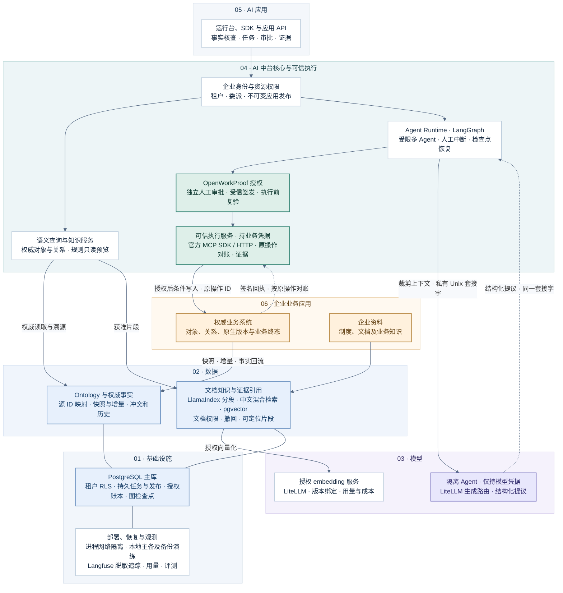

# AI Native System 六层系统架构总图

OpenWorkProof 贯穿授权与证据。PostgreSQL 承载业务状态，pgvector 承载知识向量。六层表示逻辑职责，图中另标出 Agent 与可信执行服务的边界。[高清总图](六层系统架构总图.png)

## 可编辑架构关系

## 验收范围与后续工作

| 状态 | 范围 |
| --- | --- |
| 已本地验证 | 真实 PostgreSQL 与参考源上的 Ontology 权威查询、索引读取权限、独立只读预览授权、中文混合检索、发布固定与回滚、签名授权、条件写入、回执对账与 Agent 隔离。已演练两个执行副本在同步备库人工晋升后恢复 |
| P9 检索待补 | 真实语料评测、相关性与无答案门槛校准 |
| 企业试点待验 | 真实源只读核验、规则样本、一次受控写入及第二场景复用。企业身份与密钥、自动切换、WAL 时间点恢复和生产负载待指定环境验收 |

Agent 只能向获准的模型端点发起生成，业务动作由可信执行服务派发。只读查询由可信服务读取权威事实和授权文档。执行链路以独立人工审批、OpenWorkProof、源版本及签名回执核对形成闭环。[六层架构设计](六层系统架构与复用方案-OpenWorkProof.md) · [P9 业务和检索计划](superpowers/plans/2026-11-16-six-layer-owp-integration.md#p9-检索治理与语料评测) · [本地验收记录](P9-企业试点与恢复演练.md)
