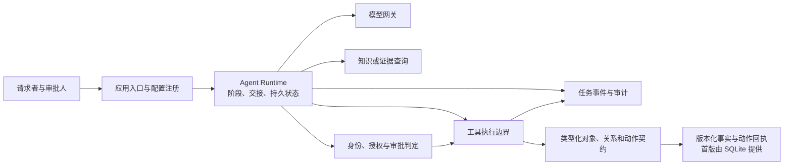
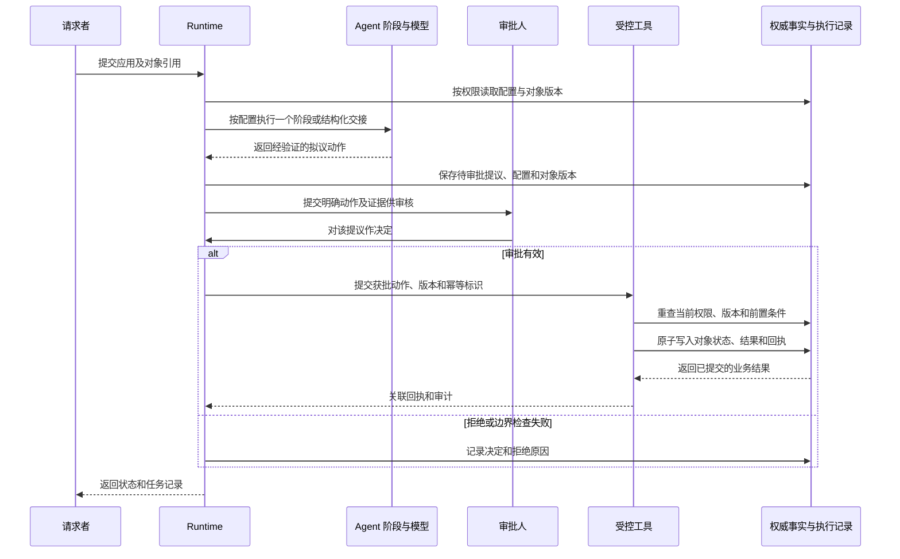

# 企业 AI 原生框架的架构解读与实现路线

企业 AI 从回答问题进入执行业务，平台就要能够确定当前事实、判断谁可以执行哪项操作，以及在进程中断后辨认操作是否已生效。AI 中台提供模型、知识、数据与工具的稳定接口。Agent Runtime 管理有状态的执行过程。Ontology 定义 Agent 能理解和请求操作的业务世界。授权、审批与审计把意图约束为可追溯的行动。这套架构适合多个应用重复使用这些能力，或已有场景对恢复和写入治理提出实质要求的企业。

本项目实现与行业无关的框架。它以配置描述应用、执行阶段、角色、对象、关系和动作，以一条单 Agent 配置和一条双 Agent 结构化交接配置检验框架契约。对应的本地运行方法与验证结果见 [README](../README.md)。

## 一、原文的七节论证与结尾

| 原文章节 | 作者的主张 | 框架如何承接 |
| --- | --- | --- |
| 1. 企业为什么需要 AI 中台 | 独立应用起步快，规模扩大后出现模型多套接入、知识重复维护、Agent 和工具反复开发。 | 建立可替换的模型、知识与工具接口，由不同应用配置共享实现。规模化收益仍需比较多个应用的接入和维护成本。 |
| 2. 企业级 AI 中台的六层架构 | 基础设施、数据、模型、AI 中台核心、AI 应用和业务应用覆盖从资源供给到业务结果的链路。Agent 一次请求的资源消耗也可能随工具和子任务扩张。 | 六层采用逻辑职责划分。本地实现将运行、状态和模拟事实保存在简单部署中，技术边界由接口和数据所有权体现。 |
| 3. 中台核心 | 中台统一提供模型、知识、Agent、工具和数据服务，并管理模型、提示词、知识、编排、权限与发布。 | 服务接口支持复用，执行记录关联所用配置与对象版本。企业试点再接入组件发布、知识维护和持续评估。 |
| 4. Agent 平台化 | 单 Agent 需要模型、指令、上下文、记忆、工具、规划、执行和评估。多 Agent 需要角色职责、状态共享、结构化交接、故障处理和成本控制。工具还要解决权限、参数、审批、异常与幂等。 | Runtime 为必要的上下文和阶段结果提供边界，结构化交接按契约校验。修改已登记对象的权限、版本、批准和动作约束集中在执行边界检查。 |
| 5. 从中台到业务应用 | 应用可组合共性能力，同时保留业务流程、数据权限和风险规则的自治。 | 公共执行和治理机制由框架提供。应用配置声明阶段、可用动作和规则，事实归其源系统。 |
| 6. 治理 | 安全合规、标准化、可观测性、运营管理都应进入设计。运行成本和成功率最终要联系业务效率和实际收益。 | 每次执行保留任务、调用、策略判定、人工批准和实际结果的关联。试点测操作准确性、人工干预、时延和业务价值。 |
| 7. 建设起点的五步法 | 先选代表性任务，提取公共能力，建立最小中台，同步设计治理，再从第二和第三个场景检验复用。 | 先让本地配置跑通同一套状态、工具和治理契约，再由试点使用实际场景、数据和评测基线检验复用。 |

原文结尾把演进方向放在业务语义与执行统一。作者用订单与生产调度讨论业务对象、关系、现实状态、规则与动作，并提到 Ontology 和 Runnable World Model。文章给出了架构主张和应用示例，结论的普适性仍需在具体系统中验证。Runnable World Model 的状态表达、未来影响推演和验证方法也需由场景定义。本项目先表达当前对象与动作允许条件，后续若需要预测连锁影响，再定义状态转换模型和预测误差的验收方式。 [智能体AI，2026 年 11 月 7 日原文](https://mp.weixin.qq.com/s/LVHOxZ8iEOAilNuHgwJK4w)

## 二、六层如何映射到参考框架

| 逻辑层 | 职责 | 首版范围 |
| --- | --- | --- |
| 基础设施 | 计算、存储、隔离、资源和运维保障 | Python 与 SQLite，提供可本地运行的进程和持久状态。 |
| 数据 | 权威对象、关系、版本化知识与可访问范围 | 用配置声明对象类型及关系，测试事实保存在本地。读取结果携带版本和来源语义，供提议、审批和写入核对。 |
| 模型 | 统一接入、输出格式和运行统计 | 具有可重复测试输出的适配器，并保留可选的本地模型接入。模型输出按阶段契约验证。 |
| 中台核心 | Runtime、工具、知识、身份权限、审批、审计 | 配置注册、阶段执行、结构化交接、状态恢复与受控写入共享同一运行机制。 |
| AI 应用 | 应用定义、规则、阶段和交互入口 | 两套通用的契约验证配置，分别覆盖单阶段和双阶段交接，使用合成数据。 |
| 业务应用 | 业务事实的权威来源与最终的动作接收方 | 首版以内置版本化对象和类型化动作模拟该层，仅写入 SQLite 内的演示对象。企业接入由实际源系统保存和确认事实。 |

首版的关键是数据归属。配置注册保存角色、类型、关系、动作、应用与执行阶段的定义。Runtime 记录流程状态、阶段输出和上下文引用。事实来源保存对象与关系的权威版本。审批是独立于模型的人的决策。动作工具依据有效配置与当前事实接受或拒绝变更，审计记录最终生效的结果。

## 三、RAG、知识图谱与可操作的 Ontology

RAG 给模型提供与任务相关的文档、规则、知识和其他依据。知识图谱表达实例之间的关系，便于追踪和查询。可操作的 Ontology 还要表达类型、唯一标识、关系含义、事实来源与允许的操作。例如，一种类型的对象通过已登记的关系指向另一类对象，应用阶段仅在源状态满足条件时提议动作。动作契约声明目标类型、参数、前置条件、审批要求和预期效果。工具执行前以最新事实核对这些条件。模型可根据检索结果生成提议，读取权限和写入许可由可信接口独立决定。 [Foundry Ontology](https://www.palantir.com/docs/foundry/ontologies/ontologies-overview) · [Foundry Action Types](https://www.palantir.com/docs/foundry/action-types/overview)

首版的对象、关联、版本和约束由配置与关系数据库承载。需要跨系统统一标识、持久维护公共语义、协调多应用配置版本或进行变更影响分析时，再评估独立的 Ontology 服务。复杂关联查询可用代表性查询测量关系库与图存储的表现。需要正式语义交换与逻辑推理时，可评估 OWL/RDF。Foundry 与 OWL 标准各提供一种可参考的技术能力，具体实现取决于对象与动作的管理要求。 [W3C OWL 2](https://www.w3.org/TR/owl2-overview/)

## 四、Runtime 如何把模型提议变成受控行动

单 Agent 配置使用一个注册阶段。双 Agent 配置有两个角色明确的阶段，后者接收前者经类型验证的结构化交接。首版应用声明动作与执行身份，由内置 SQLite 工具读取对象和写入状态。运行器分配任务 ID、检查读取权限、取上下文、驱动阶段、保存结果，满足条件后形成待审批的提议。模型产生的文本和工具返回内容按不可信输入处理。交接内容、模型建议和审批意见均须经过动作注册和工具侧校验。

批准关联确定的提议、动作参数、应用配置及对象版本。提交时若批准所依赖的版本失效，要求对新提议重新决策。执行边界分别识别请求者和审批者，重查对象权限和业务状态。模型提议和前端请求都通过同一可信工具执行写入。接入外部系统时，为执行工具分配可识别、权限受限的服务身份。

本地使用同一 SQLite 事务提交受控状态变更、动作结果与可重用回执。恢复时从持久状态判断已完成阶段，重放已生效动作可返回原有结果。企业工具跨系统后的故障语义取决于下游服务。返回超时时，仅在下游确实支持按同一操作键去重时自动重试。若下游可按业务标识查询，则先核对结果；结果仍不明时保留待对账状态供人工复核。持久工作流和业务副作用需要分别验证，尤其应注入提交前中断、业务已提交但回执未返回这两类故障。 [Temporal 活动幂等说明](https://docs.temporal.io/activity-definition#idempotency)

**MCP 是工具接入协议。** 它定义宿主、客户端和服务端之间的 JSON-RPC 消息与能力协商，支持工具发现和调用、资源及提示词。HTTP 授权规范定义受保护 MCP 服务的 OAuth 流程与访问令牌受众校验；STDIO 通常从环境获取凭据。企业对象级权限、审批绑定、业务状态约束和实际写入回执由应用及其工具服务承担。内部工具接口可依需求接入 MCP。 [MCP 规范](https://modelcontextprotocol.io/specification/2025-11-25) · [工具调用](https://modelcontextprotocol.io/specification/2025-11-25/server/tools) · [授权规范](https://modelcontextprotocol.io/specification/2025-11-25/basic/authorization) · [安全实践](https://modelcontextprotocol.io/docs/2025-11-25/tutorials/security/security_best_practices)

## 五、多 Agent 的采用条件

双 Agent 配置用于验证不同阶段能按预期交接结构化上下文并沿用同一治理边界。它提供了受控协作的机制。固定的业务规则和写入约束适合确定性流程。需要独立调查路径、不同的工具与数据权限、专业分工或可并行探索时，可加入多 Agent 对照。Anthropic 的多 Agent 研究实践是开放式并行调查的例证，性能收益受任务类型、预算、模型与评测影响，企业使用时需自行比较。 [Anthropic Agent 设计模式](https://www.anthropic.com/research/building-effective-agents) · [Anthropic 多 Agent 实践](https://www.anthropic.com/research/multi-agent-research-system)

比较应使用相同业务样本、权限条件、模型与预算，记录任务成功率、依据质量和违规操作、p95 时延、总成本及人工干预。如果额外协作在预先约定的指标上产生可重复净收益，再投入并行调度、独立 Agent 生命周期、取消、隔离和运行预算控制。首版验证的阶段协作限于已注册的结构化路径。

## 六、实现与进入企业试点的顺序

| 阶段 | 可验证交付 | 决定是否推进的证据 |
| --- | --- | --- |
| 1. 本地基础契约 | 运行单 Agent 与双 Agent 配置。覆盖类型、角色、对象、关系、动作和交接，测试动作授权、批准、版本漂移、恢复与幂等。 | 两套配置共享 Runtime、模型和工具治理入口，并能以合成输入观察每个状态转换及其依据。 |
| 2. 替换适配器 | 通过同一接口替换模型、知识查询和一个业务工具。用受控输入核对模型输出验证、超时处理、调用统计和权限。 | 接入方可以定位适配代码及配置差异。生产事实仍以业务系统为准。 |
| 3. 进入企业测试环境 | 接入工作区或租户身份、真实对象映射、人工审批入口及一个可对账的下游动作，演练版本变化、权限撤回、写入超时和恢复。 | 权限、数据范围和审批可以由可信服务证明，重复请求不引入重复业务效果，未知结果能跟踪和对账。 |
| 4. 受控业务试点 | 从实际流程选有明确人工基线的任务。先评估提议质量，随后按批准的数据和动作范围运行。对相邻场景记录新增配置和代码。 | 操作正确性、业务时间、成本和人工接管达到双方约定的条件。第二个场景能复用公共契约。 |
| 5. 扩大使用 | 按负载和风险引入部署隔离、配置版本发布与回滚、取消及预算、数据保留、备份恢复、运维告警和效果回归。通过实测决定独立 Ontology 或更灵活的多 Agent 机制。 | 容量可观测，审计符合业务要求，配置可回滚。出现权限边界失效或无法对账时，先停用对应动作并修复。 |

运行观测关注任务完成率、错误、延迟、重试次数和模型成本。业务审计关注请求者、执行身份、审批人、对象及配置版本、规则、操作与回执。生产使用时同时定义事件可见范围、敏感信息处理与保存期限，验证提示注入、越权工具调用与跨租户访问等威胁。安全测试和运行观测可对照 OWASP 与 OpenTelemetry 官方资料。 [OWASP Agentic 安全风险](https://genai.owasp.org/resource/owasp-top-10-for-agentic-applications-for-2026/) · [OpenTelemetry GenAI 语义约定](https://github.com/open-telemetry/semantic-conventions-genai)
